# mauricegarcia.com

Maurice Garcia's identity, portfolio, innovation lab and business platform. Maurice is an Experience Engineer, creative technologist and independent builder. The site holds his projects in three tracks, a Learn section, short updates, writing, a Now page, seven whole-site styles, a playable version of the site, and ways to work together.

Next.js (App Router), React, TypeScript and Tailwind v4. No database and no animation library: content is files in this repository, and the motion is CSS.

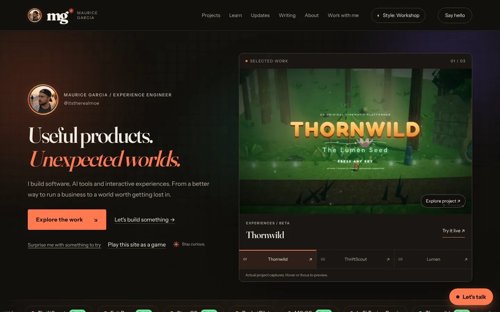

## What's on the site

### Intro and page transitions

Each browser tab plays a short intro once (about 3.4 seconds). A black hole fades in at the centre, swirls, then expands and swallows the screen. The "mg ✳" wordmark irises out of the dark, and three full-screen bands retract upward to reveal the home page that was already rendered underneath.

| 1. Swirl | 2. Swallow | 3. Wordmark | 4. Curtains lift |
| --- | --- | --- | --- |
|  |  |  | 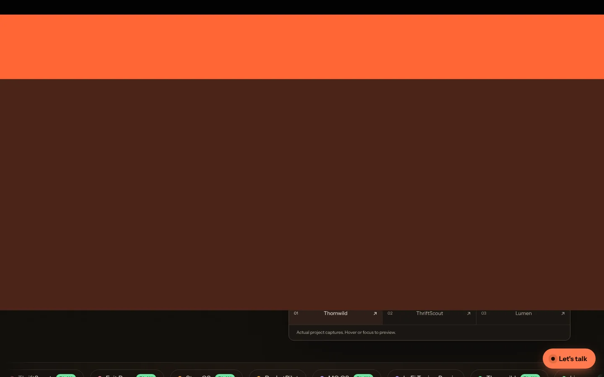 |

- **Instant.** The overlay is painted from inline CSS before hydration (background `#12100D` in the default Workshop style), so nothing flashes. Scroll is locked while it plays.
- **Once per tab.** It uses `sessionStorage`, has an 8 second failsafe, and can be skipped with a click or Esc. `?intro=1` replays it and `?intro=0` suppresses it. `/studio` and `/api` never get it.
- **Skin-aware.** The disk and the three bands take their colours from the active style's own variables, so each of the seven styles has its own palette (rust to gold in Workshop).
- **Page transitions.** Clicking an internal link plays a half-second curtain with a small black hole. Destinations in a portfolio track (Experiences, Products, Labs, including their project pages) wear that track's colour (mint, orange, lavender); everything else uses the style's accent.
- **Reduced motion.** With `prefers-reduced-motion`, the intro and the curtain become a 0.3 second fade.

The black hole itself is a small CSS-only component (`components/BlackHole.tsx`, styles in `app/motion.css`). The timeline and palettes live in `lib/motion.ts`.

### Three switchable identities

First-time visitors land on Workshop (classic): a dark, warm look with a tappable square field in the hero (`?skin=workshop`). SOFTWORKS (architectural neumorphism), MERCURY (liquid chrome) and PARALLAX (layered glass) still restyle the whole site from one component tree, each with its own navigation, hero and project layout. Switch from the header, the footer or with Alt+Shift+S; share one with `?skin=open-case`, `?skin=rogue-instrument` or `?skin=unauthorized-manual`. The seven older skins, including Workshop, stay under "More skins". See [docs/DESIGN.md](docs/DESIGN.md).

| SOFTWORKS | MERCURY | PARALLAX |
| --- | --- | --- |
| 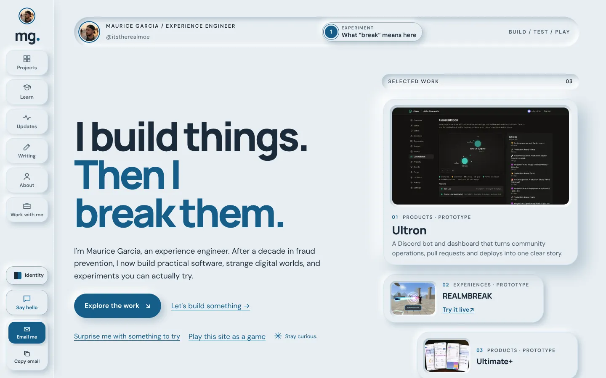 | 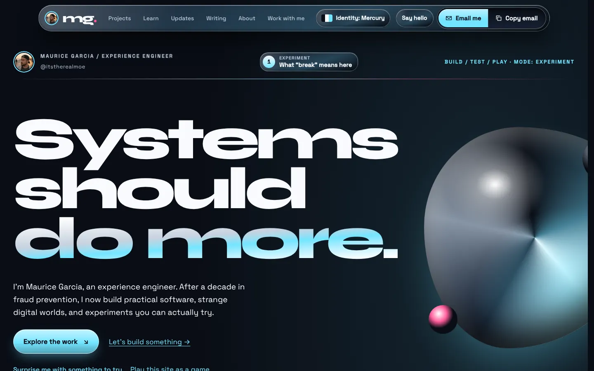 | 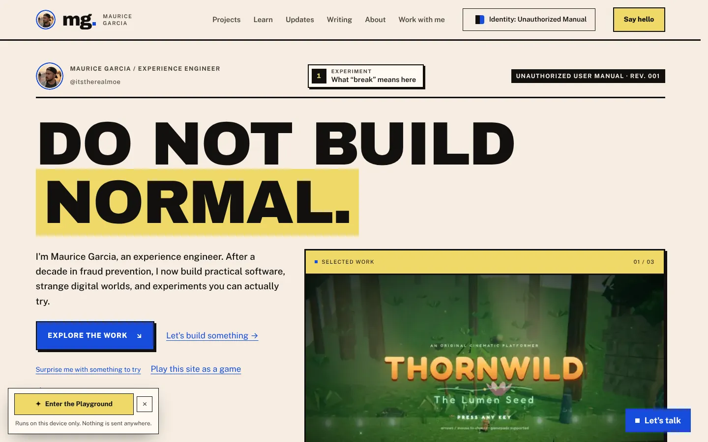 |

### Styles

Under "More skins" in the identity switcher: Workshop (classic, the default), Paper & Ink, Terminal, Neo-Pop, Glass Aurora, Swiss Grid and Arcade. The choice is remembered per browser and `?skin=terminal` links straight to one. `/lab` shows the same content as full-page design demos.

| Paper & Ink | Terminal | Neo-Pop |
| --- | --- | --- |
| 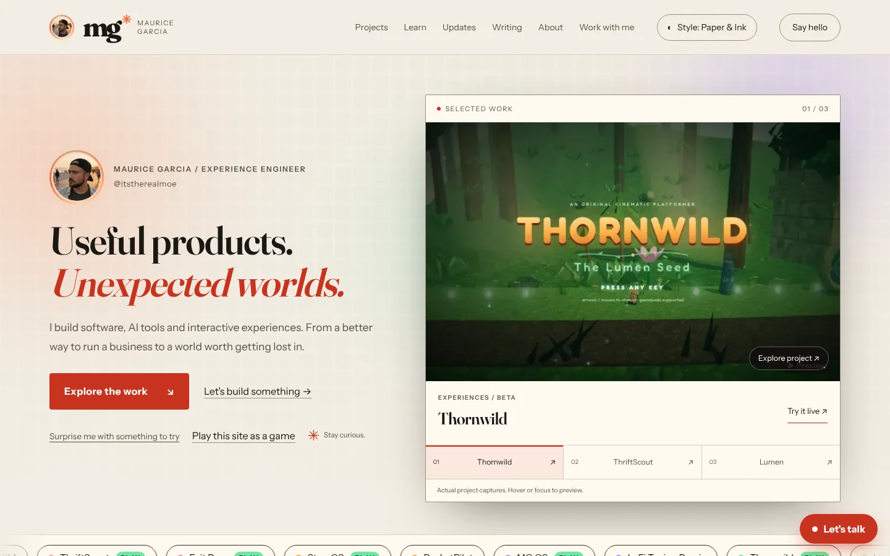 | 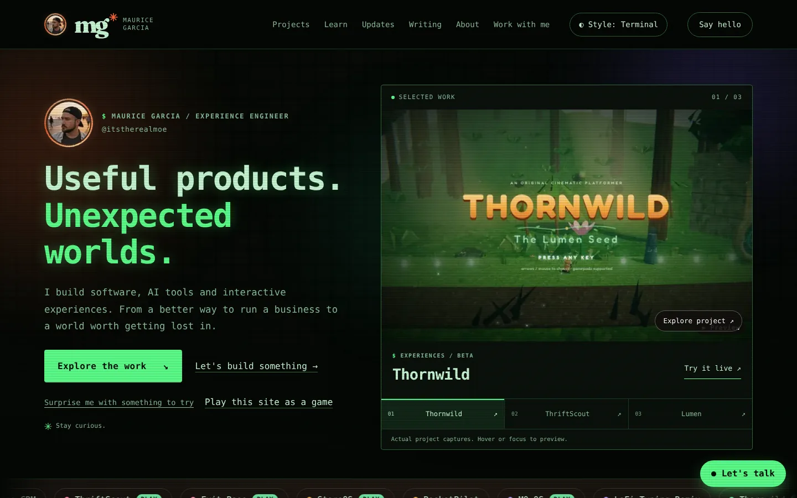 | 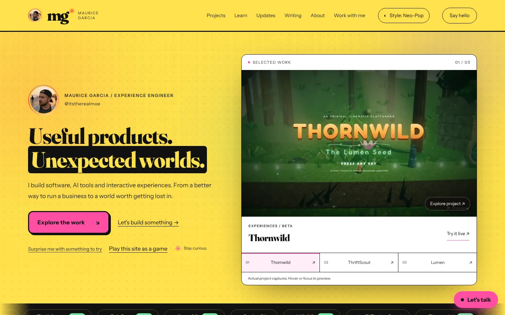 |
| **Glass Aurora** | **Swiss Grid** | **Arcade** |
| 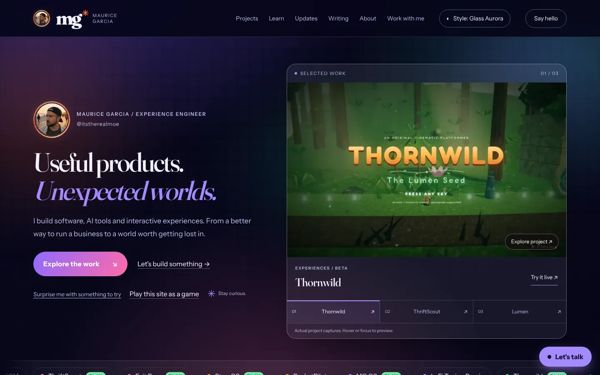 | 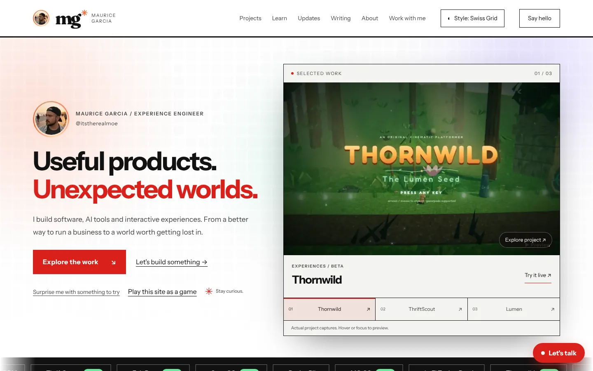 | 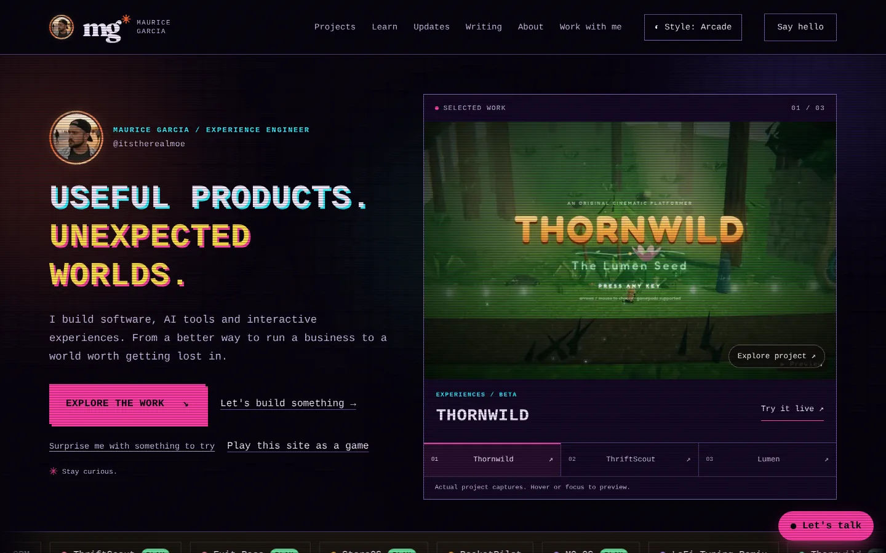 |

### Game mode

"Play this site as a game" on the home page opens `/v/game`, a playable version of the portfolio. The home page also has a Surprise me button, a Selected work player that only changes when the visitor chooses, and a few easter eggs.

### Projects

Every project is a JSON file in `content/projects/` that must say honestly how finished it is (production, beta, prototype or concept), what works today and what does not, and where each claim comes from. Three tracks: **Products** (practical software), **Experiences** (games and worlds built to be played) and **Labs** (experiments).

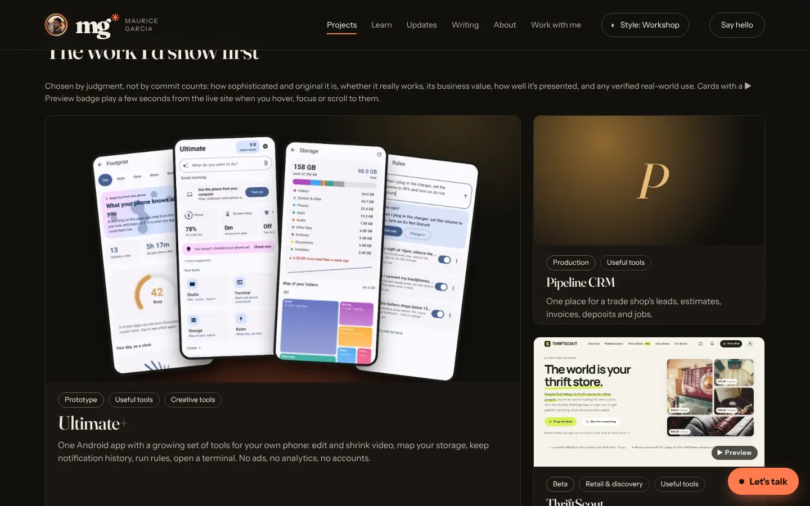

**Ultimate+** is the current lead project: one Android app with a growing set of tools for your own phone. It edits and shrinks video, maps what fills your storage, keeps notification and clipboard history, runs rules like "silence at night", and includes a terminal, an SSH client and server, privacy insights (what the phone already knows about you), a Focus companion, camera-based Air control, a Galaxy Watch app and a small on-phone AI model. It has no ads, no analytics and no accounts, and its offline edition has no internet permission. Its source version is 2.26.0 (build 148), the APKs are on its [Releases page](https://github.com/mosrvs2025/ultimate-android/releases/latest), and the site labels it a prototype, because this site has not independently built and run it. Its screenshots are the repository's own renders on a simulated phone with sample data, and every caption says so.

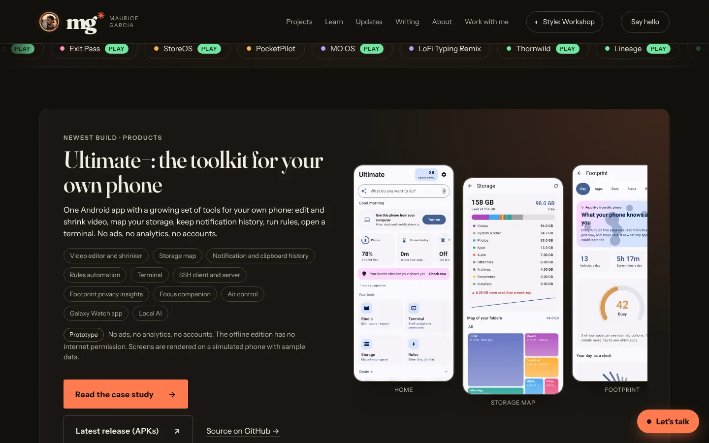

The project page has the screenshots, a case study (approach and decisions) and the limits:

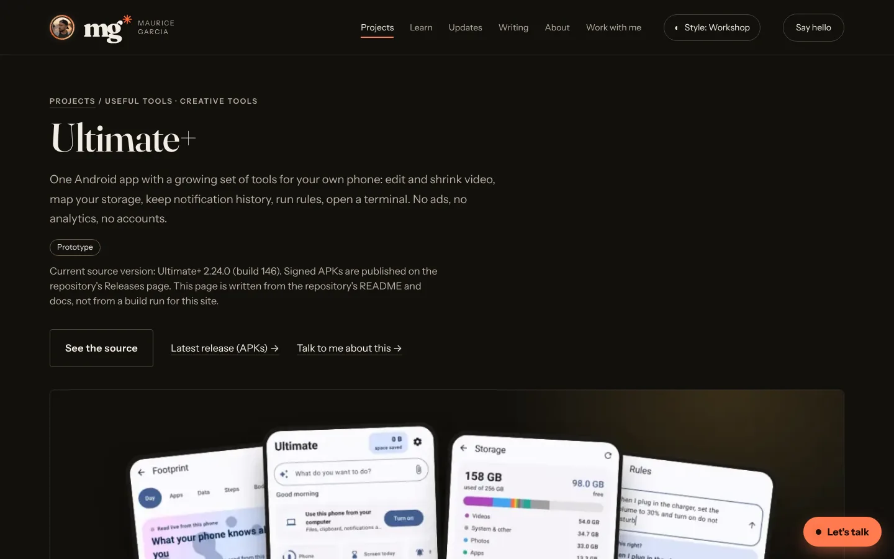

### Everything else

- **Learn, Updates, Writing, Now, About, Work with me**: files in `content/`, with RSS feeds for writing, updates and learn.
- **Contact**: a Resend-backed form with a direct-email fallback and honest failure messages. The visitor's confirmation email never repeats what they typed.
- **Shop, coaching, AI receptionist, ads**: older pages that keep their own styles.
- **Studio** (`/studio`, off until configured): the owner's Git-backed editor with save, publish and rollback.
- **Sync**: public repositories listed in `content/sources.json` become reviewed candidates for updates, never auto-published.

On a phone the home page looks like this:

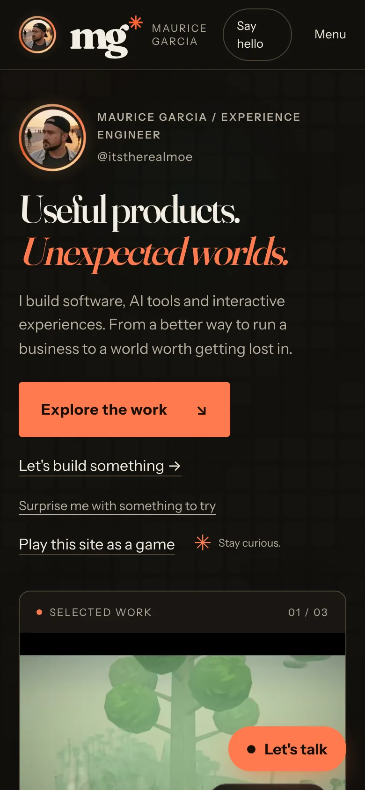

## Stack

| | |
| --- | --- |
| Framework | Next.js 16 (App Router, static generation), React 19. This Next.js has breaking changes: read the guides in `node_modules/next/dist/docs/` before changing framework-level code |
| Language and styles | TypeScript, Tailwind v4, plain CSS tokens (`app/journal.css`, `app/skins.css`, `app/motion.css`) |
| Content | JSON and Markdown files, validated by Zod schemas (`lib/content/schemas.ts`), `gray-matter` and `marked` |
| Motion | CSS keyframes and transitions, plus one small client component for page transitions. No animation library |
| Services | Resend (contact email), Stripe (shop, optional) |
| Tests | Node's test runner through `tsx`, plus a contact-flow script. Playwright is used only for screenshots |

## Run it

```bash
npm install
npm run dev                       # http://localhost:3000
SITE_PREVIEW=1 npm run dev        # also shows "proposed" content awaiting approval
```

Copy `.env.example` to `.env.local`. Nothing is required to browse the site.

## Test it

```bash
npm run verify                    # typecheck, content validation, tests, secret and private-name guards
npm run build && npm run leak-check
npm run demos:check               # every public demo link answers (add -- --browser for a real-browser check)
```

`npm run verify` is what CI runs. There is no separate lint step; types are checked by `npm run typecheck`. Rules the owner has fixed (positioning, custom-quote pricing, honest maturity labels, private names and secrets) are enforced by `tests/guardrails.test.ts` and the guard scripts; see `docs/GUARDRAILS.md`.

**Try the intro locally:** open `http://localhost:3000/?intro=1`. Turn on "Reduce motion" in your operating system to see the fade version.

**Regenerate the screenshots** in this README (they are freshly captured from a running build):

```bash
npm run build && npm start        # terminal 1
node scripts/capture-screenshots.cjs   # terminal 2; needs Playwright with Chromium and Python Pillow
```

## Map

| | |
| --- | --- |
| `content/` | Projects, updates, posts, `now.json`, `sources.json`, machine candidates |
| `lib/content/` | Schemas, loader, visibility rules (`visibility.ts` is the one gate), safe Markdown |
| `lib/motion.ts`, `components/IntroOverlay.tsx`, `components/PageTransition.tsx`, `components/BlackHole.tsx` | The intro and page transitions |
| `lib/play/`, `components/play/`, `app/play.css` | The anonymous live playground (cursors, weapons mode); see `docs/PLAYGROUND.md` |
| `components/ProjectSpotlight.tsx` | The home page feature for one project (Ultimate+) |
| `lib/sync/`, `scripts/sync.ts` | GitHub to candidates to drafts; publication rule |
| `lib/studio/`, `app/studio/`, `app/api/studio/` | Owner editor: auth, Git-backed store, save, publish, rollback |
| `.github/workflows/` | `sync.yml` (scheduled and manual), `ci.yml` |
| `docs/` | `OWNER_GUIDE.md`, `GUARDRAILS.md`, `PORTFOLIO_HIERARCHY.md`, `AGENT_HANDOFF.md`, `AGENT_SNIPPET.md`, `INVENTORY.md`, `screenshots/` |

Routes: `/`, `/learn`, `/learn/[slug]`, `/projects`, `/projects/[slug]`, `/writing`, `/writing/[slug]`, `/updates`, `/updates/[slug]`, `/now`, `/about`, `/connect`, `/services`, `/lab`, `/v/game`, plus the older `/coaching`, `/ai-receptionist`, `/shop`, `/ads`. Feeds: `/writing/rss.xml`, `/updates/rss.xml`, `/learn/rss.xml`. Moved: `/contact` to `/connect`, `/work` to `/projects/pipeline-crm`. Studio: `/studio`.

## Contact, shop and hosting

Contact submissions need `RESEND_API_KEY` and a verified `CONTACT_FROM_EMAIL`, go to hello@mauricegarcia.com with the visitor as Reply-To, and fail honestly with a direct-email fallback. The shop falls back to email without Stripe keys. Incoming mail is handled by Porkbun forwarding; Resend sends outbound form notifications. **Do not change DNS or MX records.** Import the repo on Vercel and set environment variables from `.env.example`.

## Working on this repo

Read `AGENTS.md` first. The owner's standing decisions are non-negotiable for any agent or contributor: never push to `main` (open a pull request and wait for review), no invented prices, testimonials or metrics, private repositories and client names stay out, and existing features and styles are not removed without an explicit request.
