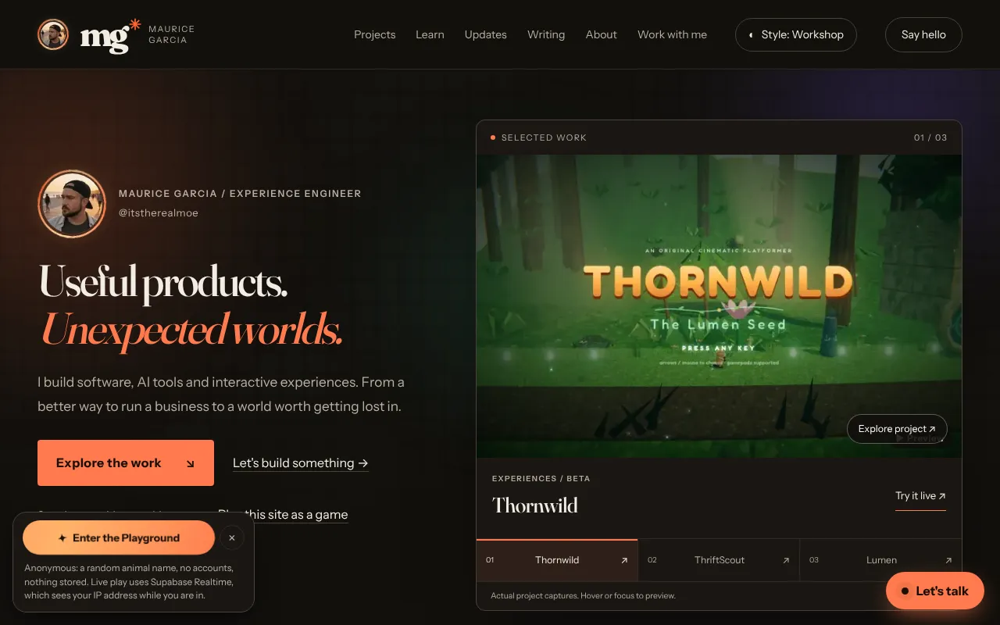
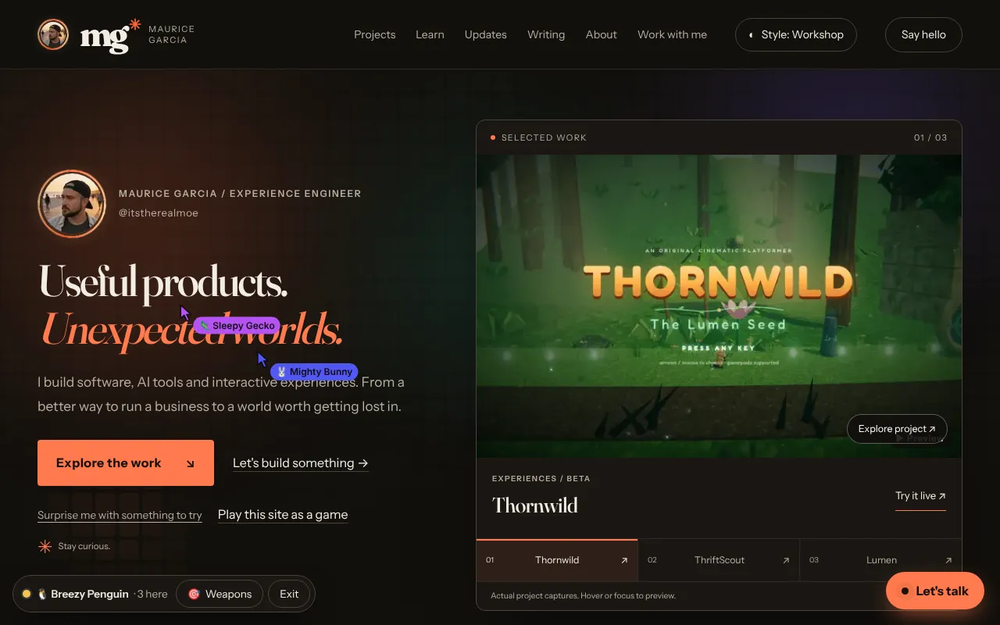
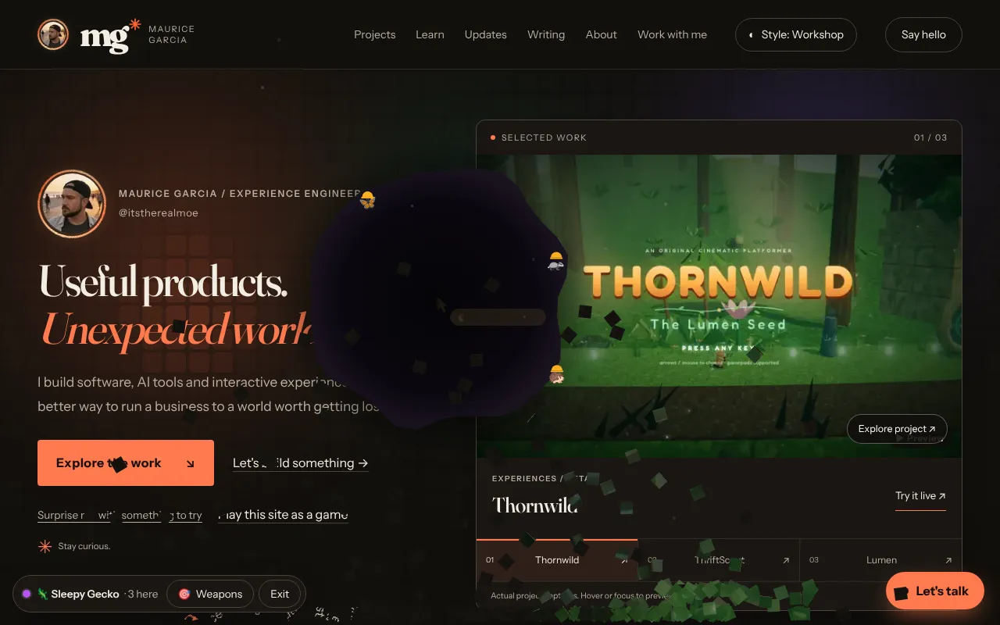
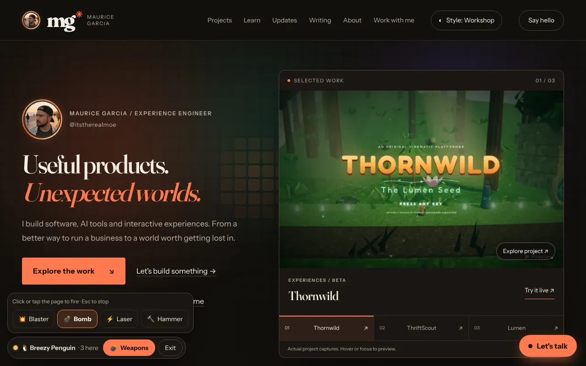
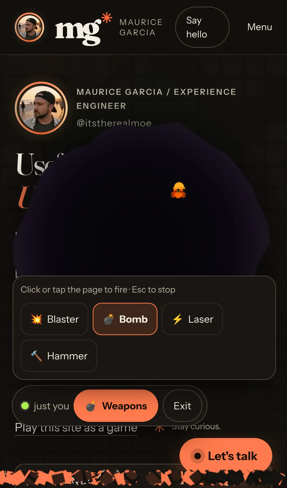

# Live playground

An anonymous, opt-in, real-time overlay: other visitors' cursors and tap ripples, plus a weapons mode (blaster, bomb, laser, hammer) that blasts the page with canvas debris, then tiny hard-hatted animals help rebuild it. The real DOM is never changed; everything is drawn on one fixed canvas.

## What visitors see
- **Nothing happens until they click "Enter the Playground".** A card (bottom-left) carries the button and a short privacy notice. It can be minimised to a small ✦ Playground pill (remembered in `localStorage` as `mg-play-min`, `"1"` minimised or `"0"` kept open; a UI preference only). On screens up to 900px it starts as the pill, on the same baseline as "Let's talk", so it never covers the hero; opening it lifts the card above that baseline. Both floating controls fade out while marked content is in the bottom band of the screen (see `FloatGuard` and "Floating controls" in `docs/DESIGN.md`).
- After entering: a dock with a random animal name and colour for this tab, how many others are on the page, a **Weapons** toggle and **Exit**. Exit disconnects and returns to the card.
- Cursors and tap ripples of visitors on the same page; their blasts appear on your screen too.
- Weapons mode: pick a weapon, click or tap the page. A crater and scorch mark appear, chunks of the page fly with physics, the page shakes a little. Tiny animal repair crews hop out once the debris settles, fetch chunks and carry them home. About 10 s after the blast the rest flies home (staggered) and the crater lifts.
- Keys while armed: `1`–`4` pick a weapon, `Esc` leaves weapons mode.

| Presence | Crew at work | Healed | Phone |
| --- | --- | --- | --- |
|  |  |  |  |

## Opt-in and privacy
- No realtime connection, request or library download happens before the click. Verified in a browser: zero WebSockets and zero requests to the provider before "Enter"; the socket closes on Exit; a new visit starts out again.
- "Entered" lives in `sessionStorage` (`mg-play-in`), so it survives reloads and navigation in that tab only. A new visit must opt in again.
- The notice on the card: *Anonymous: a random animal name, no accounts, nothing stored. Live play uses Supabase Realtime, which sees your IP address while you are in.* Without Supabase configured it says the playground runs on this device only.
- Identity is a random 8-character id per tab (`sessionStorage`). The animal name and colour are derived from it on every client, so no free text crosses the wire. No cookies, accounts, analytics ids or user agents are sent.
- Rooms are per page, named by a hash of the path, so readable (including unlisted) URLs never reach the provider.
- The provider necessarily sees an IP address while the WebSocket is open. The site stores nothing.

## Protocol
`c` cursor, `t` tap, `b` blast `{weapon, x, y, seed}`; `x` is a fraction of page width, `y` is pixels from the page top. Particle positions are never sent: every client builds the blast from the shared seed. Payloads are ~100 bytes; receivers reject anything over **1 KB**, nested, or with unknown shapes before parsing.

## Traffic control
- **Cursors:** about **4 per second while moving** (250 ms), delta-only (tiny movements skipped), always ending on the latest position, and interpolated smoothly on the receiving side.
- **Population-aware:** 250 ms up to 4 visitors, 400 ms to 10, 800 ms to 25, 1.5 s to 60, and cursors stop above 60 (taps and blasts still work). Cursors from more than 40 visitors are not drawn.
- **Background tabs:** stop sending and drop everything received immediately, leave the room after 15 s, and rejoin on return. Idle (2 min no input) tabs leave too, so they never hold a connection slot.
- **Alone in a room:** nothing is sent.
- Send budgets (token buckets): cursors 5/s (burst 2), taps 3/s (burst 4), blasts 2.5/s (burst 3), plus per-weapon cooldowns.
- Receive budgets: per sender (cursor 8/s, tap 6/s, blast 4/s) **and in total across all senders** (120/s overall, blasts 8/s, taps 25/s, cursors 60/s), so rotating fake ids cannot beat them. Tested with a hostile client sending ~48,000 junk frames: no long tasks, no frame-rate change, navigation unaffected.
- At most 12 blasts and a capped number of chunks are alive at once.

### Client-side limits are not authoritative
Supabase broadcast has no server hook. These limits keep honest clients polite and make a flood cheap to ignore, but a hostile client can skip its own sending limits, and every receiver defends itself independently. Real enforcement is the provider's project limits below. If abuse ever shows up, PartyServer on Cloudflare Workers (server-side rate limits) is the upgrade path.

### Supabase project settings (owner, in the dashboard)
Set these in the Supabase dashboard under Project Settings → Realtime settings (names can vary slightly by dashboard version). They are the only authoritative limits, and **they were not applied by this change** (no access to the project):
- Allow public access: **on** (broadcast and presence on public channels; no tables, auth or policies needed).
- Max concurrent clients: ~100 to 150 (free plan hard cap: 200).
- Max events per second: ~40 to 50 (free plan cap: 100).
- Max presence events per second: ~10.
- Max payload size: as low as the dashboard allows (messages are ~100 bytes; the client already rejects >1 KB).
- Optional: a spend/usage alert (free plan: 2M messages per month).

## Reliability
- **Disconnects:** cursors and counts clear at once, local effects keep working, the status reads "reconnecting…", and the client re-joins with a clean slate (fresh budgets, presence re-announced). After three failed joins in a row it gives up and says "local only"; weapons still work. Verified by killing and restarting the provider with three visitors connected.
- **Fallbacks:** if the page capture fails, is slow, or the device struggles, blasts use procedural chips coloured from the page's own theme. Frame time is watched; when it stays high the pixel ratio and chunk budget drop in steps, then captures stop.
- **Never blocks the page:** the canvas has `pointer-events: none` unless weapons mode is on; wheel and touch scrolling still work in weapons mode (`touch-action: pan-x pan-y pinch-zoom`; a tap fires, a scroll does not).
- **Phones:** pixel ratio capped at 1.5, 400 chunks (desktop 900), 44 px touch targets.
- **Reduced motion:** no shake, flash or crews, fewer sparks, static entry card. **Data Saver:** no page capture (procedural chips) and a small chunk budget. Both still require the visitor to opt in.
- Not shown on `/studio`, `/api` or the legacy/lab/game pages.

## Page snapshot (no dependencies)
Only the part of the blast inside the viewport is captured, once, at blast time. The custom renderer paints, in DOM order with fixed/sticky layers last: background colours with all four corner radii, CSS background images (size and position; cached for the next blast), borders (rounded when uniform), ``, `<video>` and `<canvas>` with `object-fit` and `object-position` crops, inline SVG, ancestor `overflow` clips, and text word by word at the browser's own word positions with the page's fonts, case transforms, letter spacing and underlines. Images the browser has not decoded get a muted placeholder. Not painted: gradients, shadows, filters, blend modes, pseudo-elements. Nothing is read back, so cross-origin images cannot taint it.

## Repair crews
After the debris settles (about 1.7 s) up to three animals hop out of the crater rim, each wearing a tiny hard hat, and repeatedly fetch the nearest settled chunk and carry it back to its place, until just before the heal. Purely client-side and cosmetic (no network traffic); skipped for reduced motion. Meteor showers and bosses are deliberately deferred.

## Setup (owner)
1. Create a free Supabase project (no tables or auth needed) and apply the settings above.
2. In Vercel set `NEXT_PUBLIC_SUPABASE_URL` (`https://<ref>.supabase.co`) and `NEXT_PUBLIC_SUPABASE_ANON_KEY` (the anon/publishable key). Both are public by design. **Never** use the `service_role` key here. Redeploy: they are inlined at build time.
3. Without them the playground still works solo (nothing leaves the device).
4. Kill switch: `NEXT_PUBLIC_PLAYGROUND=off` and redeploy removes it.

## How this was tested
Real Chromium via Playwright against a local mock Phoenix/Realtime server (binary broadcast frames, as the real client sends): privacy (no sockets before opt-in, socket closes on Exit, new visit asks again); three simultaneous visitors (presence count, cursors, taps, synced blasts, crews); provider outage and recovery; a hostile flooding client; desktop and iPhone 13 profile (touch tap fires, scroll works, canvas ratio 1.50, 44 px targets); keyboard-only flow and `axe-core` (no violations on the entry card, dock and armed picker); reduced motion; Data Saver; blasts at viewport edges; CPU throttling. Frame-rate overhead of the overlay in a GPU-less browser was within 1–2 fps of the page without it. **Not tested:** a real Supabase project, real-device Safari/Android, screen readers.
Known limits: the first blast may miss CSS background images that were not cached yet; gradients are not painted in the snapshot; room colours can occasionally land close together.

## Code map
`lib/play/`: `identity`, `limiter` (budgets, cursor interval), `protocol` (wire format, 1 KB validation), `session` (rooms, limits, suspend, reconnect), `transport` (Supabase + in-memory), `weapons` (deterministic shards, physics, procedural fallback), `crew`, `snapshot` (DOM → canvas), `stage` (canvas engine, governor). `components/play/Playground.tsx` is the opt-in card and dock. `app/play.css` styles. `tests/play.test.ts` covers everything except pixels.
